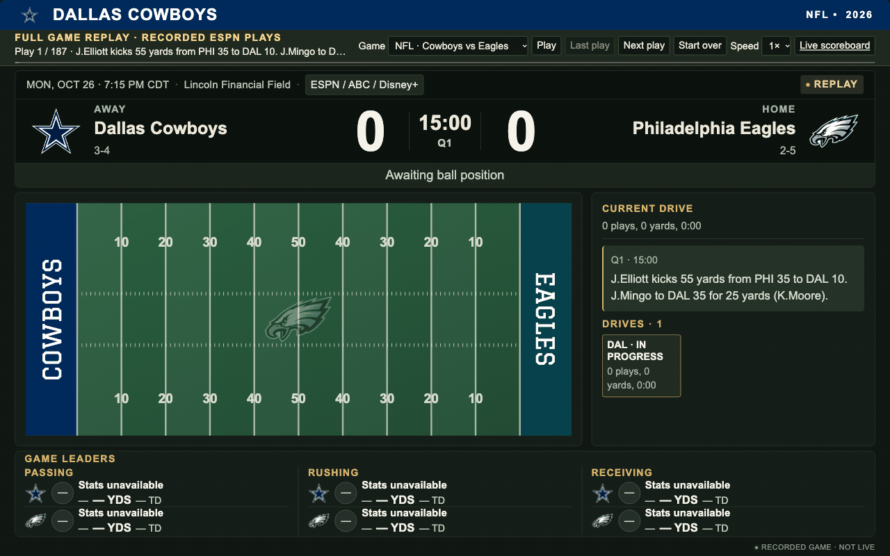

<h1 align="center">Football Scoreboard</h1>

<p align="center">
  Your team. Every game. An always-on NFL and college football display.
  <br />
  Run it in your browser, or build a dedicated Raspberry Pi scoreboard.
  <br />
  <a href="#about">About</a>
  ·
  <a href="#run-locally">Run locally</a>
  ·
  <a href="#raspberry-pi-build">Raspberry Pi build</a>
  ·
  <a href="docs/README.md">Documentation</a>
</p>



*All 187 recorded plays of Dallas–Philadelphia, ending Dallas 38–21 Philadelphia.
Updated trajectories keep the football and blue line together; incompletions leave both in place.
Player statistics are reconstructed after each play.
[Try the full-game replay locally](http://localhost:4173/?demo=drive).*

## About

Football Scoreboard turns a browser into a dedicated display for your favorite
NFL or NCAA football team. Keep it open on your desk, put it on a shelf, or mount
a small screen in a shadow box for an always-on game-day scoreboard.

- **Follow your team:** scores, records, game status, kickoff times, and TV listings.
- **See the game unfold:** recent plays and a schematic field with reported ball
  position when live data is available.
- **Celebrate big plays:** brief screen takeovers for touchdowns, interceptions,
  fumbles, made field goals, safeties, first downs, made extra points, punts,
  and blocked punts.
- **Look ahead:** the next matchup and ESPN's pregame win-chance estimates, when available.
- **Make it yours:** choose an ESPN team page and time zone in one configuration file.
- **Switch favorites:** tap Cowboys, Longhorns, or UTSA logo/mascot buttons;
  customize the scrollable favorites row in `config.json`.

The app is a small Node.js server and a browser-based display, with no third-party
packages or build step. It refreshes every 15 seconds from five minutes before
kickoff through the game, and every 30 seconds otherwise; it is not a video stream
or real-time player tracker. Between games, it shows the most recent result and
previews the next matchup. In the final 24 hours before kickoff, that matchup
takes over with a ticking `HH:MM:SS` countdown in place of the score.

> [!IMPORTANT]
> This is an independent project, not affiliated with ESPN, the NFL, the NCAA,
> or any team. It uses unofficial ESPN endpoints, which can change or be
> unavailable. No API key is required, but public access is not a reuse license.
> Review the [data-source limitations and access terms](docs/data-sources.md)
> before using or deploying it. Team names and artwork belong to their owners.

## Run locally

You need [Node.js](https://nodejs.org/en/download) **20 or newer** (prefer a
currently supported LTS release), npm, a modern browser, and internet access
for game data and team artwork.

1. Clone the repository and enter its directory:

   ```sh
   git clone https://github.com/nicholasfrei/football-scoreboard.git
   cd football-scoreboard
   ```

   Alternatively, use **Code → Download ZIP** on GitHub, extract it, and open
   a terminal in the extracted directory.

2. Start the server:

   ```sh
   npm start
   ```

3. Open **<http://localhost:4173>**. Stop the server with **Ctrl+C**.

To preview the final 24-hour kickoff countdown without waiting for a real game,
open the [sample Cowboys–Eagles countdown](http://localhost:4173/?demo=countdown).
It uses a bundled matchup with a simulated kickoff 24 hours after you open the page;
the clock ticks locally and the preview never polls the live score feed.

No `npm install` is needed: the app uses only Node.js built-in modules.

**See it in action:** open [the full-game replay](http://localhost:4173/?demo=drive)
to step through every recorded play of Cowboys–Eagles (NFL) or Texas–Ole Miss
(college football). Select a game, use **Last play** and **Next play** to test
scores, penalties, and field position, or play automatically at 1× or 2×.
The recorded summaries are bundled locally; replay does not poll ESPN. Historical
play data is not a recording of the live feed, so field position is inferred
from each play rather than a saved live game situation.
In the NFL replay, the Game Leaders panel reconstructs passing, rushing, and
receiving totals after each play; its final totals are checked against the saved
box score. These are replay estimates, not archived live-stat snapshots.

### Choose your team

The included `config.json` starts with the **Dallas Cowboys** and includes
**Texas Longhorns** and **UTSA Roadrunners** as tappable favorites. Customize
the `favorites` array as described in [configuration](docs/configuration.md#favorite-teams-on-the-touchscreen).
For a single-team Cowboys display, replace its contents with:

```json
{
  "teamUrl": "https://www.espn.com/nfl/team/_/name/dal/dallas-cowboys",
  "timeZone": "America/Chicago"
}
```

Save the file, restart `npm start`, and reload the browser. For another team,
copy its ESPN NFL or college-football **team page** URL—not a schedule or game
page. See [configuration](docs/configuration.md) for supported URLs, time zones,
and running on a different port.

## Raspberry Pi build

For a compact shelf or wall display, start with:

- **Raspberry Pi 4 (2 GB or more)** and its compatible USB-C power supply.
- **32 GB or larger microSD card** with Raspberry Pi OS 64-bit **with Desktop**.
- **7-inch Raspberry Pi Touch Display 2**, its Pi 4-compatible DSI ribbon and
  power lead; alternatively, a small HDMI monitor with its own power supply
  and a micro-HDMI-to-HDMI cable.
- **Ventilated shadow box, deep frame, or small desktop enclosure**, sized to
  the assembled display and Pi—not just the screen diagonal.
- **Standoffs, panel brackets, a bezel, and cable strain relief**; add
  weight-rated wall hardware if mounting it.

Bench-test the display first, run the app on the Pi, then configure Chromium to
open it in full-screen kiosk mode at boot. Mount the electronics securely with
airflow and a removable back. A 7-inch screen is best for close viewing; choose
a larger monitor for across-the-room readability.

The [Raspberry Pi build guide](docs/raspberry-pi.md) covers parts, installation,
automatic startup, mounting, and checks before leaving it running unattended.
No soldering, LED matrix, or physical moving ball is required.

## Documentation

- [Documentation index](docs/README.md)
- [Configuration and troubleshooting](docs/configuration.md)
- [Display behavior and highlight previews](docs/display-behavior.md)
- [Raspberry Pi setup and mounting](docs/raspberry-pi.md)
- [Data sources and access terms](docs/data-sources.md)
- [Team artwork and color sources](docs/branding.md)

## Developing

Run the tests with `npm test`. They cover configuration, countdowns, refresh timing,
game selection, and feed normalization without calling ESPN. One hundred complete game
fixtures (50 NFL and 50 NCAAF) replay all 18,379 plays from both teams' perspectives;
see [fixture provenance and replay limits](test/fixtures/games/README.md).
The server entry point is `server.js`,
the data adapters and normalization live in `src/`, and the display lives in
`public/`. See the [code map](docs/README.md#code-map) for more detail.
